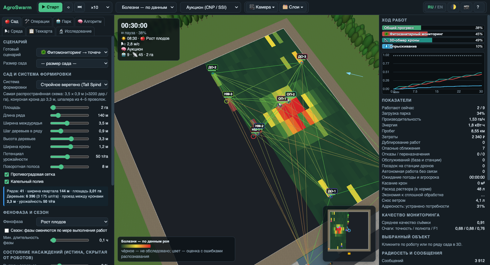
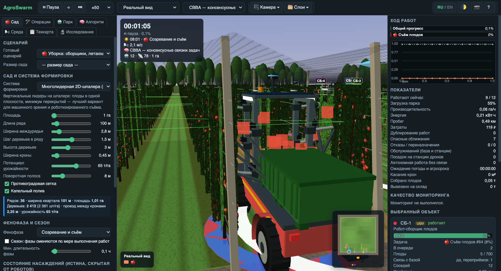
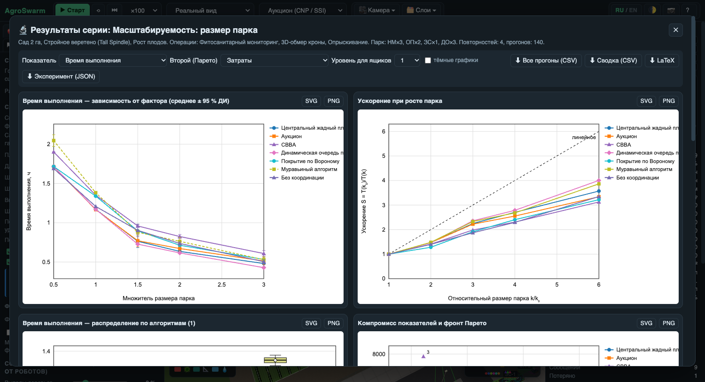
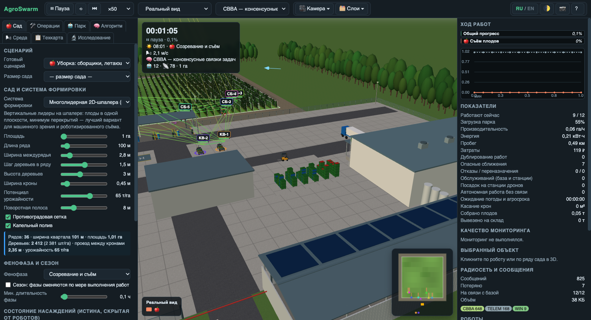

# AgroSwarm — симулятор роевой робототехники для промышленного сада

**AgroSwarm** — браузерный 3D-симулятор и исследовательский стенд роя сельскохозяйственных роботов в интенсивном яблоневом саду на шпалере. Он моделирует наземные роботизированные платформы и БПЛА, мониторинг сада машинным зрением, адресные технологические операции, радиосвязь, погоду и агросроки. Стенд рассчитан на научную работу: серии экспериментов, статистика, графики и экспорт для статей.

*AgroSwarm is a browser-based 3D swarm-robotics simulator and research testbed for commercial apple orchards: UAV and UGV monitoring with a computer-vision sensing model, targeted orchard operations, multi-robot task allocation, mesh networking and built-in experiment statistics. [English summary below](#english).*

**Демо:** [alexeykutyrev.pro](https://alexeykutyrev.pro), раздел AgroSwarm. Доступ по паролю, его можно запросить по почте [alexeykutyrev@gmail.com](mailto:alexeykutyrev@gmail.com).

## Содержание

- [Для чего нужен](#для-чего-нужен)
- [Сад](#сад)
- [Мониторинг и модель распознавания](#мониторинг-и-модель-распознавания)
- [Технологические операции](#технологические-операции)
- [Техника и автоподбор парка](#техника-и-автоподбор-парка)
- [Алгоритмы координации роя](#алгоритмы-координации-роя)
- [Исследовательский модуль](#исследовательский-модуль)
- [Скриншоты](#скриншоты)
- [Модель симуляции](#модель-симуляции)
- [English](#english)
- [Контакты](#контакты)

## Для чего нужен

- **Исследователям** — сравнивать алгоритмы роевого управления и распределения задач на одной модели сада, получать графики и статистику для публикаций.
- **Агроинженерам и хозяйствам** — оценивать, сколько и какой техники нужно на сад заданной площади, чтобы уложиться в агросрок.
- **Разработчикам систем машинного зрения** — видеть, как высота, скорость съёмки, камера и освещённость влияют на качество данных и на результат последующих операций.
- **Преподавателям и студентам** — наглядно изучать точное садоводство, роевой интеллект и мультиагентные системы.

## Сад

Модель — интенсивный яблоневый сад на карликовом подвое со шпалерой, капельным поливом и противоградовой сеткой.

- **Системы формировки:** стройное веретено (3,5 × 0,9 м), суперверетено (3,2 × 0,5 м), плодовая стена (3,0 × 0,8 м), многолидерная 2D-шпалера (2,8 × 1,5 м).
- **Размеры:** от 0,5 до 100 га; настраиваются длина ряда, междурядье, шаг деревьев, высота и ширина кроны, урожайность, поворотная полоса.
- **Фенофазы:** покой, цветение, завязь, рост плодов, созревание. В режиме «сезон» фазы сменяются по мере выполнения работ.
- **Состояние насаждений:** выпады деревьев, очаги болезней, перегрузка урожаем, дефицит питания, отказы капельного полива, сорняки в приствольной полосе, неоднородный объём кроны. Это «истина», которую роботы не видят напрямую.
- **3D:** деревья на шпалере со столбами, проволокой и капельной линией, сетка над рядами, цветки и плоды по фазам, двор хозяйства с фруктохранилищем, сортировочной линией, контейнерной площадкой и погрузчиками.

## Мониторинг и модель распознавания

| Операция | Носитель и сенсор | Результат |
|---|---|---|
| Инвентаризация насаждений | БПЛА, RGB в надир | число деревьев, выпады |
| Учёт цветков, завязей и плодов | наземная платформа со стереокамерами и подсветкой; БПЛА на низком пролёте | нагрузка, прогноз урожая |
| Фитосанитарный мониторинг | наземная платформа; БПЛА | очаги болезней листьев и плодов |
| Мультиспектральная съёмка | БПЛА, 5 каналов | дефицит питания, сорняки |
| Тепловизионная съёмка | БПЛА | водный стресс, отказы полива |
| 3D-обмер кроны | наземная платформа с лидаром | объём кроны для нормы опрыскивания |

Распознавание выполняют свёрточные нейронные сети — детекторы объектов и модели сегментации. В симуляторе их работа описана моделью качества съёмки: итоговое качество — произведение факторов разрешения (высота, камера), смаза (скорость и выдержка), освещённости (время суток, собственная подсветка), перекрытия листвой (система формировки, фенофаза, ракурс) и ветра. Низкое качество даёт пропуски очагов, ложные срабатывания и ошибку учёта. Рой принимает решения по своей оценке, а не по истине, поэтому ошибки мониторинга переходят в недообработку или перерасход.

Считаются точность, полнота и F1 обнаружения очагов, ошибка учёта (MAPE и смещение), доля найденных выпадов, адресность обработки.

## Технологические операции

Контурная обрезка, подсадка на месте выпадов, скашивание междурядий, обработка приствольной полосы, подкормка, ремонт капельного полива, опыление дронами, прореживание цветков и завязей, опрыскивание (сплошное, по очагам и с нормой по объёму кроны), защита от заморозков, съём плодов с вывозом контейнеров.

Цепочка «мониторинг → карта → адресная операция» — основной роевой сценарий: разведчики находят потребность, исполнители обрабатывают только нужные ряды.

## Техника и автоподбор парка

15 типов машин. Наземные: платформа мониторинга, вентиляторный опрыскиватель, универсальное шасси, робот обрезки и прореживания, сервисный манипулятор, мобильный теплогенератор, сборщик плодов, контейнеровоз, мобильная станция дронов. Воздушные: БПЛА мониторинга, агродрон-опрыскиватель, дрон-опылитель, летающий сборщик, тяжёлый БПЛА для перемешивания воздуха, ретранслятор связи.

Парк подбирается автоматически при выборе операций и площади:

`n = ⌈ S / (W₀ · τ · T) ⌉`

где `S` — площадь операции (для адресных — доля сада с потребностью), `W₀` — производительность чистой работы, `τ` — доля рабочего времени с учётом разворотов, заправок и замены АКБ, `T` — агросрок. К расчёту добавляются контейнеровозы, станции дронов и ретрансляторы. Состав затем можно менять вручную, а расчёт — проверить серией прогонов.

## Алгоритмы координации роя

| Группа | Алгоритмы |
|---|---|
| Централизованные | жадный планировщик, венгерский алгоритм, статическое разбиение по рядам |
| Рыночные и консенсусные | аукцион (CNP / SSI), CBBA, консенсус границ зон, динамическая очередь рядов, покрытие Вороного (Ллойд) |
| Биоинспирированные | муравьиный (ACO), рой частиц (PSO), серые волки (GWO), пчелиный (ABC), пороговая модель разделения труда, светлячки |
| Поведенческие | бойды Рейнольдса, лидер–ведомые |
| Базовые | без координации, случайный поиск (полёты Леви) |

Алгоритм можно менять во время симуляции.

## Исследовательский модуль

- **Планы экспериментов:** сравнение алгоритмов, масштабируемость по размеру парка, площадь сада, отказы, потери пакетов, дальность связи, ветер, БПЛА против наземных платформ, высота и скорость съёмки, время начала работ.
- **Повторности:** каждая реплика — новая реализация сада и новая последовательность отказов и потерь связи.
- **Графики (SVG):** зависимость от фактора со средними и 95 % доверительными интервалами, ящики с усами, ускорение при росте парка, компромисс двух показателей с фронтом Парето.
- **Статистика:** среднее, стандартное отклонение, доверительный интервал, медиана; критерий Краскела–Уоллиса, попарный критерий Манна–Уитни с поправкой Холма, размер эффекта A₁₂.
- **Показатели:** время, производительность, энергия, затраты, загрузка, сообщения, дублирование, качество мониторинга, адресность, экономия препаратов, урожай.
- **Экспорт:** CSV со всеми прогонами и сводкой, SVG и PNG графиков, таблица LaTeX, JSON с полной конфигурацией для воспроизведения.

Интерфейс и подписи графиков переключаются между русским и английским.

## Скриншоты

| | |
|---|---|
|  |  |
| Карта болезней «по данным роя» | Роботизированный съём плодов |
|  |  |
| Результаты серии экспериментов | Двор хозяйства и фруктохранилище |

## Модель симуляции

Ряд шпалеры с половинами соседних междурядий делится на отрезки около 12 м. Наземные машины идут по междурядью и разворачиваются на поворотных полосах; дроны летят над сеткой. Учитываются заряд АКБ, ёмкость баков и контейнеров, обслуживание на базе и на мобильных станциях, ветер и снос, дождь, ночь, отказы. Радиосеть — граф по дальности связи с потерями и задержками; распределённые алгоритмы обмениваются сообщениями только внутри связной компоненты.

Технологии: JavaScript без фреймворков, WebGL, Three.js. Установка не нужна.

## English

**AgroSwarm** is an interactive 3D **swarm-robotics simulator for commercial orchards** that runs entirely in the browser. It models an intensive trellised apple orchard and a heterogeneous fleet of ground robots (UGV) and drones (UAV).

- **Orchard model:** four training systems (tall spindle, super spindle, fruiting wall, multi-leader 2D planar), 0.5–100 ha, five growth stages, hidden ground truth: missing trees, disease hotspots, over-cropping, nutrient deficiency, drip failures.
- **Monitoring:** tree inventory, flower / fruitlet / fruit counting, phytosanitary scouting, multispectral and thermal surveys, LiDAR canopy scanning — by UAVs and ground platforms.
- **Sensing model:** imaging quality depends on ground sampling distance, motion blur, light, leaf occlusion and wind, producing misses, false alarms and counting error. The swarm acts on its estimate, not on the truth.
- **Operations:** hedging, replanting, mowing, tree-strip weeding, fertilising, drip repair, drone pollination, thinning, variable-rate spraying, frost protection, robotic picking with bin logistics.
- **Fleet sizing:** the fleet is sized automatically from area, operations and agronomic windows, then validated by simulation.
- **18 coordination algorithms:** greedy, Hungarian, auction (CNP / SSI), CBBA, consensus, Voronoi / Lloyd, ACO, PSO, grey wolf, artificial bee colony, response threshold, firefly, Reynolds flocking, leader–follower and baselines.
- **Research module:** replicated experiment plans, SVG charts with 95 % confidence intervals, box plots, speed-up curves, Pareto fronts, Kruskal–Wallis and Mann–Whitney tests with Holm correction, export to CSV, SVG, PNG, LaTeX and JSON.
- **Bilingual interface:** Russian and English, including chart labels.

Built with vanilla JavaScript, WebGL and Three.js. Live demo: [alexeykutyrev.pro](https://alexeykutyrev.pro) (password-protected, access on request: [alexeykutyrev@gmail.com](mailto:alexeykutyrev@gmail.com)).

## Контакты

- Email: [alexeykutyrev@gmail.com](mailto:alexeykutyrev@gmail.com)
- Сайт: [alexeykutyrev.pro](https://alexeykutyrev.pro)

Вопросы, сотрудничество и доступ к демо — по почте.

---

**Ключевые слова:** роевая робототехника, рой роботов, промышленный сад, интенсивный яблоневый сад, шпалера, точное садоводство, мониторинг сада, БПЛА, агродроны, наземные роботизированные платформы, подсчёт плодов, учёт цветков, инвентаризация насаждений, фитосанитарный мониторинг, машинное зрение, распределение задач, мультиагентные системы, роевой интеллект, муравьиный алгоритм, рой частиц, аукцион задач, CBBA, технологическая карта, цифровой двойник, симулятор, WebGL.

*Keywords: swarm robotics, orchard robotics, apple orchard, trellis, precision horticulture, orchard monitoring, UAV, UGV, fruit counting, blossom counting, tree inventory, disease detection, computer vision, multi-robot task allocation, multi-agent systems, swarm intelligence, ACO, PSO, CBBA, auction, coverage path planning, fleet sizing, digital twin, agricultural simulator, WebGL, Three.js.*

© Alexey Kutyrev
