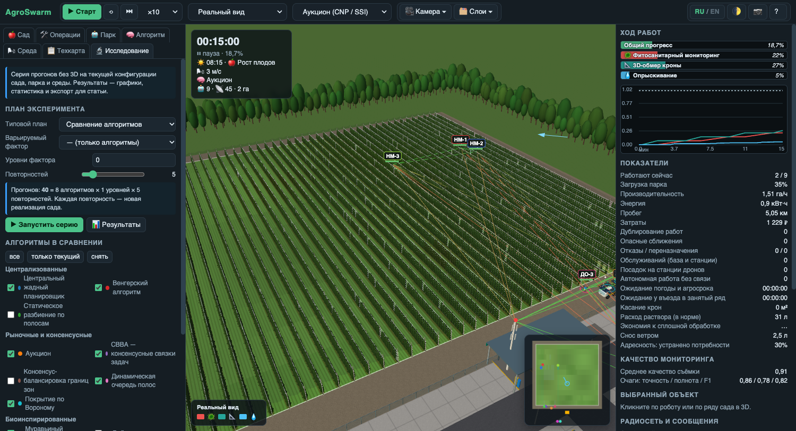
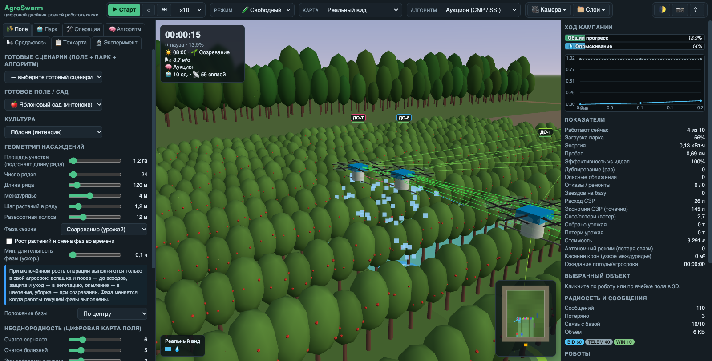
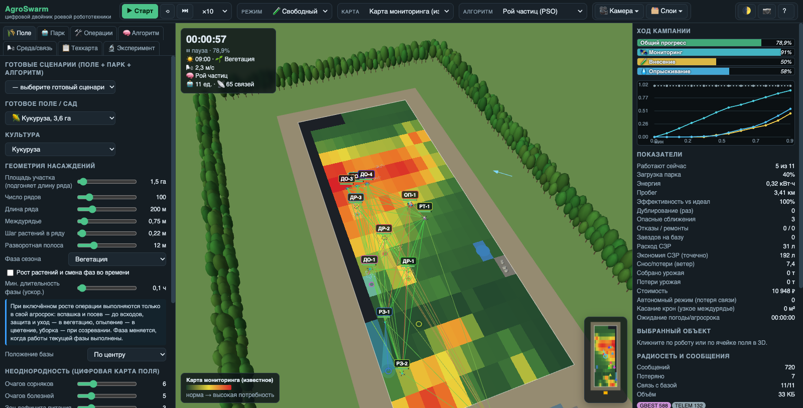
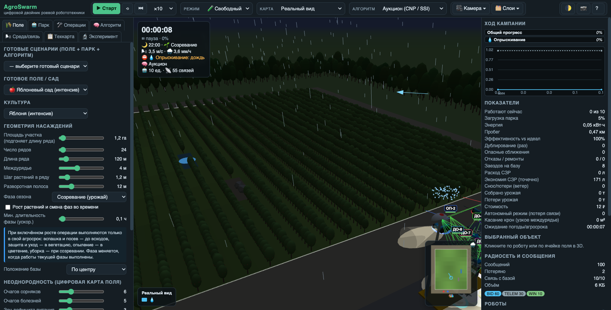
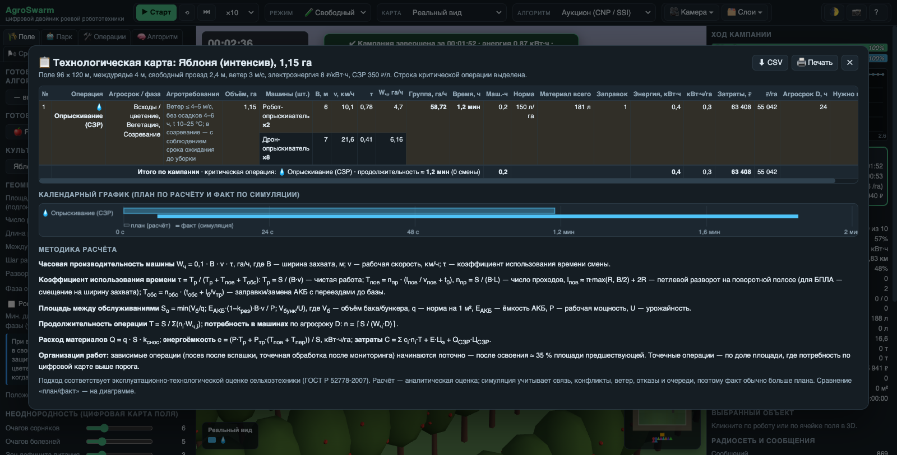

# AgroSwarm — симулятор роевой робототехники для сельского хозяйства

**AgroSwarm** — браузерный 3D-симулятор и цифровой двойник роя сельскохозяйственных роботов: беспилотных тракторов, агроботов и агродронов. На модели поля или сада он показывает, как группа наземных роботов (UGV) и беспилотников (UAV) делит работу, держит радиосвязь, реагирует на погоду, отказы и агросроки, и сравнивает 18 алгоритмов координации роя.

*AgroSwarm is a browser-based 3D swarm robotics simulator and digital twin for precision agriculture: multi-robot task allocation for ground robots and agricultural drones, mesh networking, weather and an agronomic technology map. [English summary below](#english).*

**Демо:** [alexeykutyrev.pro](https://alexeykutyrev.pro), раздел AgroSwarm. Доступ по паролю, его можно запросить по почте [alexeykutyrev@gmail.com](mailto:alexeykutyrev@gmail.com).

## Содержание

- [Для чего нужен](#для-чего-нужен)
- [Возможности](#возможности)
- [Алгоритмы координации роя](#алгоритмы-координации-роя)
- [Техника и культуры](#техника-и-культуры)
- [Технологическая карта](#технологическая-карта)
- [Скриншоты](#скриншоты)
- [Модель симуляции](#модель-симуляции)
- [Технологии](#технологии)
- [English](#english)
- [Контакты](#контакты)

## Для чего нужен

- **Исследования** в роевой робототехнике и мультиагентных системах: распределение задач (multi-robot task allocation), покрытие территории, устойчивость к отказам и потере связи.
- **Точное земледелие**: оценить, сколько роботов и дронов нужно для операции, сколько уйдёт времени, энергии и средств защиты растений (СЗР), и сколько сэкономит точечная обработка по карте мониторинга.
- **Обучение**: наглядная демонстрация алгоритмов (аукцион, CBBA, муравьиный, рой частиц, бойды) для студентов аграрных и технических вузов.
- **Проектирование парка** беспилотной сельхозтехники и сравнение стратегий координации до испытаний в поле.

## Возможности

### Поля, сады и культуры
- 16 культур: зерновые, пропашные, промышленные сады, виноградники и ягодники; 15 готовых полей и 10 готовых сценариев.
- Настройка геометрии: число и длина рядов, междурядье, шаг растений, разворотные полосы, препятствия (пруды, камни).
- Цифровая карта неоднородности: очаги сорняков, болезней, дефицита питания и засухи, потенциал урожайности.
- Техника, деревья и растения в **реальном масштабе 1:1**; есть фигура человека ростом 1,8 м для сравнения.
- Фазы сезона и **рост растений во времени**: операции выполняются только в свой агросрок.

### Беспилотная техника
- 19 типов наземных роботов (UGV) и дронов (UAV): от робота-трактора и комбайна до дрона-опылителя, дрона-ретранслятора и мобильной зарядной станции.
- Параметры каждого типа: рабочая и транспортная скорость, ширина захвата, мощность, ёмкость АКБ, баки и бункеры, радиус связи, стоимость часа работы.
- **Проходимость**: габариты машины сравниваются со свободным проездом между кронами; касание крон учитывается в показателях.
- **Мобильные зарядные станции (дронопорты)**: наземные платформы с тремя посадочными площадками. Рой станций сам располагается по краям поля возле групп дронов (алгоритм Ллойда на границе поля с отталкиванием станций), дроны выбирают станцию по «ставке» (время полёта + очередь + запас раствора), садятся, автоматически меняют АКБ и дозаправляются. Разряженная станция сама уезжает на базу.
- **Машинный двор** как в реальном хозяйстве: пункт техобслуживания у поля, навес-гараж с машиноместами, зарядными постами и солнечными панелями, дронопорт с посадочными площадками, мастерская с мойкой, склады СЗР, удобрений и семян, контора, КТП, водонапорная башня, зернохранилище, автовесы на въезде.
- Детальные 3D-модели техники: колёса с грунтозацепами, датчики (лидар, ГНСС RTK, камеры), плуги, сеялки, штанги опрыскивателей, жатка комбайна, манипуляторы; дроны с лучами, моторами, винтами, огнями и посадочными лыжами.

### Технологические операции
Мониторинг (мультиспектральная съёмка, NDVI), вспашка, посев, внесение удобрений, опрыскивание СЗР, прополка, полив, опыление, обрезка, уборка урожая с логистикой: тележки и грузовые дроны забирают урожай у сборщиков.
**Точечный режим**: обработка только тех участков, где мониторинг обнаружил проблему выше порога, с подсчётом экономии химии.

### Связь, погода и надёжность
- Mesh-радиосеть: многохоповая маршрутизация, потери пакетов, задержки, связные компоненты; распределённые алгоритмы обмениваются сообщениями только внутри своей компоненты.
- Ветер с порывами и суточным ходом, снос при опрыскивании, запрет полётов при сильном ветре.
- Дождь: приостанавливает опрыскивание, внесение удобрений и полив, замедляет технику на мокрой почве.
- Смена дня и ночи: фары, навигационные огни, ограничения на съёмку и опыление в темноте.
- Ошибка позиционирования (RTK или обычный GPS), случайные отказы и ремонт.

### Эксперименты и режимы
- Автоматическое **сравнение всех алгоритмов** на одном поле с повторами и взвешенным баллом: время, энергия, стоимость, нагрузка на связь, дублирование работ, опасные сближения.
- Кривые **масштабирования** по числу роботов (насыщение, убывающая отдача).
- Экспорт временных рядов и журнала запусков в CSV, сохранение и загрузка сценариев в JSON.
- Режимы: **обучение** по шагам, **песочница** (ручное назначение задач, охранные зоны, отказы), **испытания** с целями и оценкой звёздами.
- Камеры: свободная, от первого лица (из кабины робота), «кино»; мини-карта; светлая и тёмная тема.
- Карты данных: реальный вид, выполненные операции, сорняки, болезни, дефицит питания, влажность, карта мониторинга, потенциал урожая, зоны роботов, феромоны ACO.

## Алгоритмы координации роя

| Семейство | Алгоритмы |
|---|---|
| Централизованные | Центральный жадный планировщик · Венгерский алгоритм (оптимальное назначение) · Статическое разбиение по полосам |
| Рыночные и консенсусные | Аукцион (Contract Net Protocol / SSI) · CBBA (Consensus-Based Bundle Algorithm) · Консенсус-балансировка границ зон · Динамическая очередь полос · Покрытие по Вороному (алгоритм Ллойда) |
| Биоинспирированные | Муравьиный алгоритм (ACO, стигмергия) · Рой частиц (PSO) · Серые волки (GWO) · Пчелиный алгоритм (ABC) · Пороговая модель разделения труда · Светлячки (Firefly) |
| Поведенческие | Бойды Рейнольдса (флокинг) · Лидер–ведомые (движение строем) |
| Базовые (для сравнения) | Без координации (ближайшая задача) · Случайный поиск (полёты Леви) |

Алгоритм можно сменить прямо во время работы: роботы освобождают задачи и перераспределяют их по новой стратегии.

## Техника и культуры

**Наземные роботы (UGV):** робот-трактор, робот-сеялка, робот-разбрасыватель удобрений, робот-опрыскиватель, робот-поливальщик, малый робот-прополщик, универсальная платформа, робот-комбайн, робот-сборщик плодов, робот-обрезчик, транспортный робот-тележка, мобильная зарядная станция (дронопорт) с тремя посадочными площадками.

**Дроны (UAV):** дрон-разведчик с мультиспектральной камерой, дрон-опрыскиватель, дрон-разбрасыватель, дрон-опылитель, дрон-сборщик плодов, тяжёлый грузовой дрон, дрон-ретранслятор связи.

**Культуры:** пшеница озимая, кукуруза, подсолнечник, соя, рапс, картофель, сахарная свёкла, яблоня (интенсивный сад), груша, черешня и вишня, персик, олива, цитрусовые, виноград на шпалере, клубника, малина.

## Технологическая карта

Встроенная агротехнологическая карта рассчитывает кампанию по методике эксплуатационно-технологической оценки сельхозтехники (ГОСТ Р 52778-2007):

- часовая производительность **W = 0,1·B·v·τ** (га/ч), где B — ширина захвата, v — рабочая скорость, τ — коэффициент использования времени;
- **τ = Tр / (Tр + Tпов + Tобс)**: учитываются петлевые развороты на поворотной полосе, заправки, замена АКБ и переезды до базы;
- продолжительность операций и всей кампании по критическому пути, **потребность в машинах** для заданного агросрока;
- расход семян, удобрений, СЗР и воды с учётом сноса, число заправок, энергоёмкость (кВт·ч/га), затраты (₽/га);
- календарный график, на котором расчёт сравнивается с фактом симуляции; печать и экспорт в CSV.

## Скриншоты

| Агродроны над садом | Точное земледелие: карта мониторинга |
|---|---|
|  |  |
| **Ночная работа под дождём** | **Технологическая карта** |
|  |  |

## Модель симуляции

Поле делится на полосы, сегменты и ячейки. Наземные роботы движутся по междурядьям и разворачиваются на загонах с учётом минимального радиуса поворота. Дроны летают напрямую в нескольких высотных эшелонах над пологом растений и отталкиваются друг от друга. Учитываются расход энергии и груза, ёмкость баков и бункеров, очереди на обслуживание, связность радиосети, влияние ветра и дождя, отказы и влияние каждой операции на урожай. Распределённые алгоритмы обмениваются заявками только внутри своей связной компоненты сети, так что потеря связи действительно влияет на результат.

## Технологии

JavaScript без фреймворков, WebGL и [Three.js](https://threejs.org/) (инстансинг десятков тысяч растений), Canvas 2D для графиков, Web Crypto. Работает в браузере на компьютере и телефоне без установки. В этом репозитории лежит **собранная версия** (минифицированные скрипты и стили), которую сайт загружает через jsDelivr.

## English

**AgroSwarm** is an interactive 3D **swarm robotics simulator for agriculture** that runs entirely in the browser. It models a field, orchard or vineyard as a digital twin and simulates a heterogeneous fleet of **agricultural robots (UGVs) and drones (UAVs)** performing scouting, tillage, seeding, fertilizing, spraying, weeding, irrigation, pollination, pruning and harvesting with logistics.

Key features:

- **18 multi-robot task allocation and coordination algorithms**: greedy, Hungarian, auction (Contract Net / SSI), CBBA, consensus, Voronoi/Lloyd coverage, ant colony optimization (ACO), particle swarm optimization (PSO), grey wolf optimizer (GWO), artificial bee colony (ABC), response-threshold model, firefly, Reynolds boids flocking, leader–follower formation, plus baselines.
- **Mesh networking** with multi-hop routing, packet loss and latency; distributed algorithms only communicate within connected components.
- **Mobile drone docking stations**: a swarm of ground charging robots positions itself along the field edge (Lloyd's algorithm on the boundary), drones bid for the best station and land for automatic battery swap and refill.
- **Farm machinery yard**: equipment sheds with charging bays, drone port, workshop, storage, grain silos; detailed 3D models of all machines.
- **Environment**: wind and gusts, spray drift, rain, day/night cycle, GNSS error, failures and repair, crop growth stages and agronomic time windows.
- **Precision agriculture**: drone scouting builds a monitoring map, and variable-rate treatment saves agrochemicals.
- **Technology map**: field capacity W = 0.1·B·v·τ, time-utilization coefficient, critical path, required fleet size, inputs, energy and cost, with plan vs. simulation comparison.
- **Experiments**: batch benchmarking of all algorithms, scalability curves, CSV/JSON export; tutorial, sandbox and challenge modes; first-person and cinematic cameras.

Built with vanilla JavaScript, WebGL and Three.js. Live demo: [alexeykutyrev.pro](https://alexeykutyrev.pro) (password-protected, access on request: [alexeykutyrev@gmail.com](mailto:alexeykutyrev@gmail.com)).

## Контакты

- Email: [alexeykutyrev@gmail.com](mailto:alexeykutyrev@gmail.com)
- Сайт: [alexeykutyrev.pro](https://alexeykutyrev.pro)

Вопросы, сотрудничество и доступ к демо — по почте.

---

**Ключевые слова:** зарядная станция для дронов, дронопорт, замена АКБ, роевая робототехника, рой роботов, сельскохозяйственные роботы, агроботы, агродроны, беспилотная сельхозтехника, точное земледелие, цифровой двойник поля, симулятор, мультиагентные системы, распределение задач, алгоритмы роя, муравьиный алгоритм, рой частиц, CBBA, аукцион, технологическая карта, умное сельское хозяйство, агро 4.0.

*Keywords: drone docking station, battery swap, swarm robotics, agricultural robots, agricultural drones, precision agriculture, digital twin, multi-robot task allocation, multi-agent systems, swarm intelligence, UAV, UGV, smart farming, agriculture 4.0, simulator, Three.js, WebGL.*

© Alexey Kutyrev
